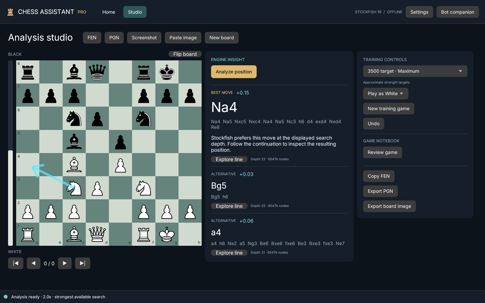

# RbChessAssist

A native Rust chess studio for Windows. Analyze a position with Stockfish 19, review a completed game, or practice against five engine-strength targets. Stockfish analysis runs locally. The Chess.com companion draws move suggestions directly on the website. An optional Chrome extension provides automatic connection; a bookmark connection is also available.



## Download and launch

Download **RbChessAssist-Windows.zip** from [Releases](https://github.com/rashadbasirat/rbchessassist/releases/latest). Extract the entire archive, then double-click **RbChessAssist.exe**. Keep the `stockfish` folder beside the executable. Python and Rust are unnecessary for running the packaged application. Windows 10/11, x64, and an OpenGL-capable graphics driver are required. The executable is unsigned.

## Features

- **Automatic Chrome connection:** open Connection in the app and click Prepare automatic Chrome connection. In Chrome extensions, enable Developer mode, choose Load unpacked, and select the copied folder. Reload Chess.com once and allow the local app connection if prompted. After setup, Start/Stop works without bookmark clicks. The extension is limited to Chess.com and its private pairing files stay on your computer.
- **Start helping / Stop helping** for your existing signed-in Chess.com tab in Chrome. Add the **Connect RbChessAssist** bookmark once, then click it on your game. A turquoise move arrow and controls appear directly on the website. No extension or separate Chrome profile. See [connection instructions](docs/COMPANION.md).
- **Details** immediately below the helping button: move instructions, observable tactical facts, material balance, expected reply, engine continuation, alternatives and related book passages. **Analyze deeper** requests up to 15 seconds of analysis. A single settled suggestion is displayed after each search. Details shows numbered turquoise, red and blue arrows for the suggested move, expected reply and following move.
- **Six complete classic books**, about 411,000 words, embedded locally with a searchable reader. Related passages are retrieved by keyword and attributed to their source. Historical book advice is separate from Stockfish's calculation.
- **Review game** opens the current captured or local game directly. Legal website moves retain their history, and the latest game is saved locally across restarts. If only a position was captured, the button opens PGN import instead. Review every move, see per-player counts of Brilliant, Great, Best, Excellent, Good, Inaccuracy, Mistake and Blunder, inspect the evaluation graph, and compare with the engine's preferred line. These are RbChessAssist's documented criteria, not Chess.com's proprietary classifications.
- Interactive board with legal moves, castling, en passant, all four promotions, coordinates, move animation, check highlights, and three board themes.
- **Maximum strength** in Settings: full skill, 10 seconds per position, depth ceiling 60, up to 8 CPU threads, 512 MB hash and one focused candidate. Website analysis respects your time setting. Review uses three candidates and reuses each position result.
- Full-strength Stockfish analysis with one to three candidates, actual engine scores, best-move arrows, principal variations, and forced mate distances.
- Step through an engine continuation without changing the game. Evaluation is always from White's perspective.
- Local play as White, Black, or a random color. Five approximate targets of 1500, 2000, 2500, 3000, and maximum strength. Undo, resign, hints, and draw claims.
- FEN validation, PGN mainline import/paste, move navigation, PGN export, and board image export.
- Completed-game review, move classifications, missed mate notices, an evaluation graph, and estimated accuracy for each player.
- Import a screenshot or clipboard image. Native-theme board detection and actual template matching identify pieces. A manual correction editor confirms turn, castling rights, and en passant before loading.
- Configurable CPU threads, hash memory, time limit, depth ceiling, MultiPV, sound, animation, and local settings persistence.
- Optional Polyglot opening books and Syzygy tablebases. These datasets are supplied by the user.
- Background engine searches with cancellation, stale-result rejection, crash reporting, and subprocess cleanup.

See [the illustrated user guide](docs/USER_GUIDE.md), [classification methodology](docs/METHODOLOGY.md), and [test report](docs/TEST_REPORT.md).

## Build from source

Install stable Rust from rustup.rs and the Microsoft C++ build tools for the default Windows MSVC target. Then run in PowerShell from this project folder.

```powershell
./build/setup-engine.ps1
cargo test --locked -- --test-threads=2
node tests/browser.cjs
cargo build --release --locked
./build/package.ps1
```

The local development build also supports Rust's GNU Windows toolchain with a compatible MinGW linker. Machine-specific linker configuration is excluded from the repository. Cargo.lock records the exact dependencies. GitHub Actions tests and packages the MSVC build on Windows. Pushing a `v*` tag publishes the packaged binary as a GitHub Release.

## Project layout

| File | Responsibility |
| --- | --- |
| `src/ui.rs` | Native egui interface, board interaction, dialogs and animations |
| `src/game.rs` | Shakmaty chess rules, FEN, PGN, draw handling and explanations |
| `src/engine.rs` | UCI subprocess, cancellation, review, classification and opening books |
| `src/vision.rs` | Board localization, image templates, recognition and board export |
| `src/browser.rs` | Authenticated localhost bookmark connection and background coaching |
| `src/browser_model.rs` | Position validation and detailed move guidance |
| `src/library.rs` | Six complete classic books and passage search |
| `assets/browser/` | Page board decoder, move arrow and website control panel |
| `src/companion.rs` | Legal move synchronization and legacy capture utilities |
| `src/settings.rs` | Configuration, validation and persistent local storage |
| `tests/core.rs` | Rules, engine, mate, scoring, imports and recognition tests |
| `build/` | Engine setup and portable Windows packaging |

## Scope and limitations

The project uses Rust, egui, Shakmaty, and Rust image processing following the author's request to switch from the original Python specification. Its computer-vision implementation performs pixel template matching. Recognition supports the included piece set and board themes. Unfamiliar pieces, perspective photographs, highlights, overlays, and severe compression may require manual correction. No image classifier can recover missing game-state metadata from a screenshot.

Strength targets are approximate. Stockfish's supported Elo range is respected, and maximum strength disables weakening. The 3500 label is an aspirational target, not a measured rating or guarantee. Analysis always runs at full strength. Time and depth limits apply together, and the first reached ends the search.

The app imports the first PGN game's mainline. Nested variations, comments, and annotations are skipped. It does not provide a variation-tree editor. Exported PGN uses an ongoing/unspecified result (`*`), so edit that header when archiving a completed result. Website coaching requires desktop Google Chrome and either the automatic connection extension or the Connect bookmark. With the bookmark method, click the bookmark again after reloading the tab. Chrome may request local/loopback connection permission. The app respects that permission and does not disable browser security. Future site or browser changes can require updates. If full FEN state is unavailable, start a fresh game or load the current FEN. One connected game tab is supported at a time. The screenshot importer is a separate feature with narrower theme support.

The missing-material display can be affected by promotions or a custom starting FEN.

Stockfish does not negotiate draw offers through UCI. The interface supports rule-based draw claims and automatic stalemate, insufficient-material, fivefold-repetition, and 75-move draws. Threefold and 50-move claims are available for the current position. Prospective claims by declaring a future move are not implemented. Extremely rare dead positions beyond the rules library's insufficient-material detection may require adjudication.

Move explanations report verifiable features such as captures, checks, promotion, castling, and central occupation. They do not invent long strategic explanations. Brilliant/great labels and accuracy are documented heuristics, distinct from any commercial platform's ratings. They depend on search quality and should be treated as training aids.

Use this application for training, completed-game review, and explicitly authorized engine-assisted games. The coach reads the board without classifying the opponent. It never clicks or plays moves. The local WebSocket server binds only to `127.0.0.1:38271` and requires both a personal random pairing token and a Chess.com origin. It accepts board snapshots and limited coaching controls, not arbitrary code or filesystem requests. The app does not copy browser profiles, read passwords, or upload positions or screenshots. Keep your personal bookmark private. Closing the app closes its local connection.

## Licensing

GPL-3.0-or-later. See [LICENSE](LICENSE) and [THIRD_PARTY.md](THIRD_PARTY.md). Stockfish is distributed with its upstream source and GPL license. Shakmaty and the chess piece artwork also have GPL-compatible licenses. Inter is distributed under the SIL Open Font License. Source code for the application is available in this repository.

The six historical books are public domain in the USA. Their Project Gutenberg notices and licenses are retained. See [book sources](docs/BOOKS.md).
