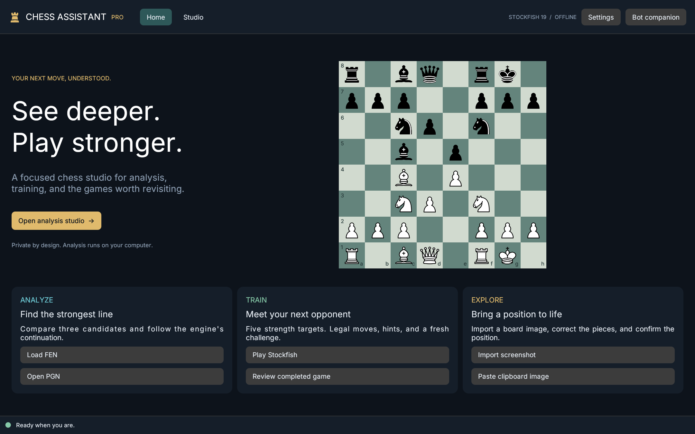
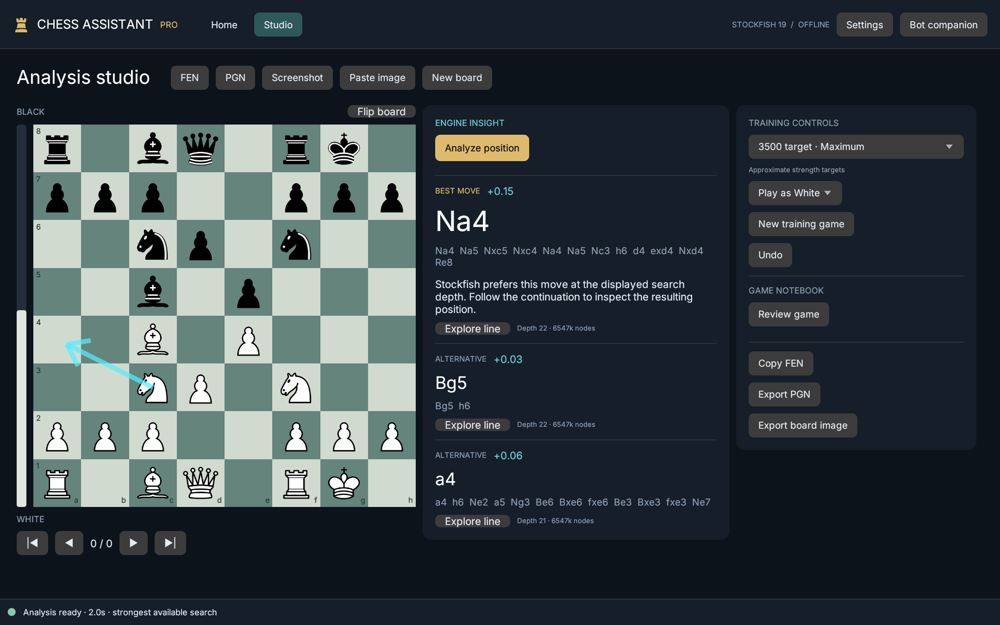

# RbChessAssist user guide

## Start on Chess.com

Click **Start helping**, then the **Connect RbChessAssist** bookmark on your existing Chess.com tab. The arrow and **Details** panel appear directly on the website. The app minimizes after connecting and continues running in the background. See the [connection guide](COMPANION.md) for one-time setup.

## Open the offline studio

Choose **Studio** from the compact app to open the offline workspace. **Load FEN** accepts a complete position string. **Open PGN** reads a game file, and **Review completed game** accepts pasted notation. **Play Stockfish** starts a training game using the selected strength.

## Analyze and explore

Click a piece, then its destination. Legal destination dots appear after selection. Castling uses the king's destination square. Promotion opens a choice of queen, rook, bishop, or knight.

Select **Analyze position**. The middle panel displays Stockfish's best move, score, search depth, and continuation. Alternative moves appear when MultiPV is greater than one. Positive scores favor White. The evaluation bar grows upward for White's advantage. A mate label is based on the engine's reported result.

**Explore line** opens the candidate continuation on the board. Use the line arrows to step forward or back, then **Exit** to return to the game. History controls below the board and move entries in the notebook let you inspect earlier positions.

## Train against Stockfish

Choose a strength target and color in the right panel, then **New training game**. Click a piece and its destination to play. The engine responds in the background. **Get a hint** performs a full-strength analysis. **Undo** takes back a full pair of moves when appropriate. **Resign** ends the training game. A **Claim draw** button appears when the current position meets threefold repetition or the fifty-move rule.

## Review a game

Click **Review game · import PGN** on the main screen. Paste a PGN or choose a file, then click **Analyze and review game**. Progress appears in the bottom status bar. The report shows estimated accuracy per side, counts of all eight move labels for each player, an evaluation graph, centipawn losses, classification explanations, preferred engine lines and missed forced mates. Click a move to inspect its resulting position. Cancel is available while reviewing.

The quality of review depends on the time/depth budget. Increase analysis time in Settings for difficult positions. The methodology document explains the exact classification and accuracy formulas.

## Import a screenshot

Use **Screenshot** to choose a PNG/JPEG or **Paste image** to import an image explicitly copied to the clipboard. The editor shows the original image and a board preview.

Adjust X, Y, and Size so the cyan crop covers exactly the eight-by-eight board, then choose **Detect pieces**. Native piece artwork and the app's three themes are supported. Yellow borders identify uncertain cells. Select an uppercase piece for White or a lowercase piece for Black, then click a square to correct it. **Erase** removes a piece. **Rotate recognized position** reverses orientation.

Confirm the side to move, castling rights, and en passant square. Blank castling and en passant fields mean no rights and no en passant square. Choose **Confirm & load position** after reviewing all squares. Invalid positions remain in the editor with an error message.

## Settings and offline use

Settings control analysis seconds, maximum depth, threads, hash memory, candidate count, board theme, coordinates, arrow, animation, and sound. **Save settings** persists them locally. Settings are also saved on normal exit.

The engine executable can be selected manually if the bundled path is unavailable. Optional Syzygy tablebases and a sorted Polyglot `.bin` opening book can be installed locally. Book moves use the highest-weight legal matching entry. Books apply only to engine play. Clearing optional datasets returns to engine-only play.

The bottom bar reports engine failures. Correct the executable path if necessary, then select Analyze again. Closing the app cancels searches and terminates its Stockfish processes.

## Chess library

Click **Chess library · 6 books** on the main screen. Choose a complete book to read, or search all six for concepts such as development, centre, rook or ending. The books remain available offline. Source links and original license text are retained.
